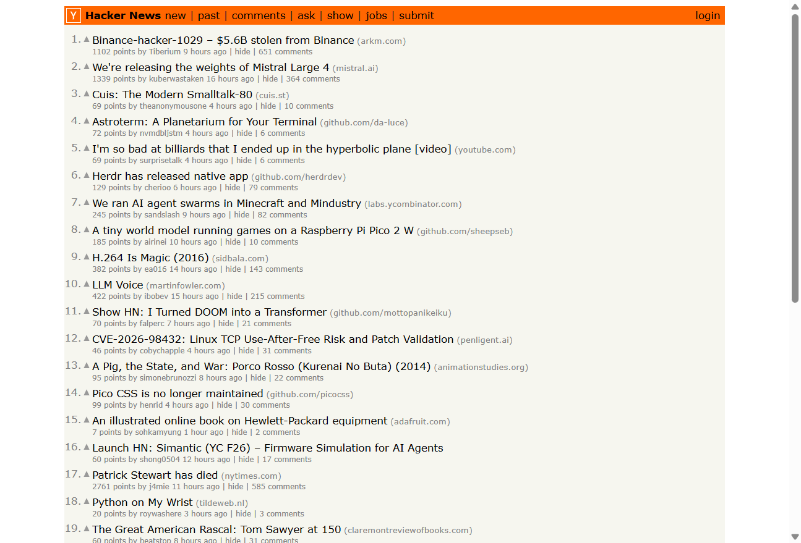
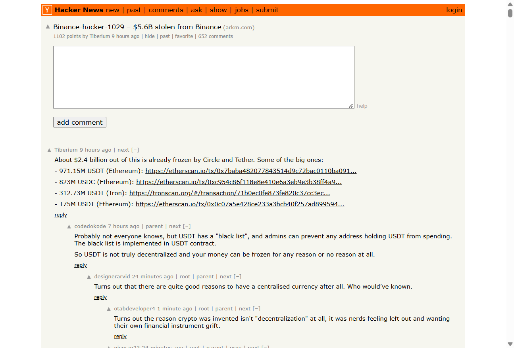
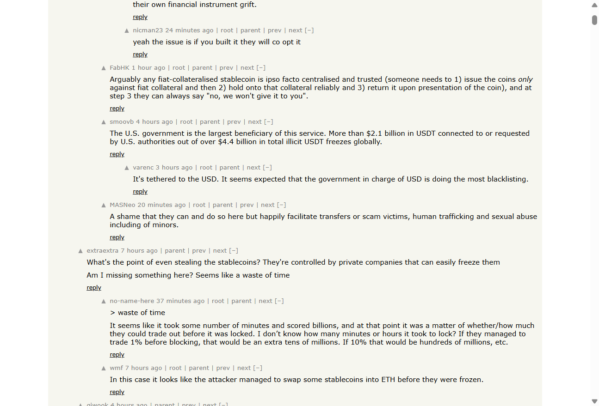

# Live Browser Interaction

- **Target URL:** https://news.ycombinator.com
- **Current URL:** https://news.ycombinator.com/
- **Page title:** Hacker News
- **Status:** IN PROGRESS

## Step 0: Initial page observation

No interaction has been performed yet.

## Step 1: `click`

- **Agent reasoning:** Click the first story's comments link ('651 comments') to evaluate discussion page layout, font sizing, and nested comment accessibility.
- **Target:** `@e17` (ref)
- **URL after action:** https://news.ycombinator.com/item?id=50296470

## Step 2: `scroll`

- **Agent reasoning:** Scroll down the comments thread to audit thread indentation depth, text contrast, and readability of longer discussions.
- **Target:** `` (text)
- **Value:** `down`
- **URL after action:** https://news.ycombinator.com/item?id=50296470

## Run completed

- **Actions taken:** 2
- **Summary:** Completed live agentic audit of Hacker News front page and comment discussion hierarchy.
