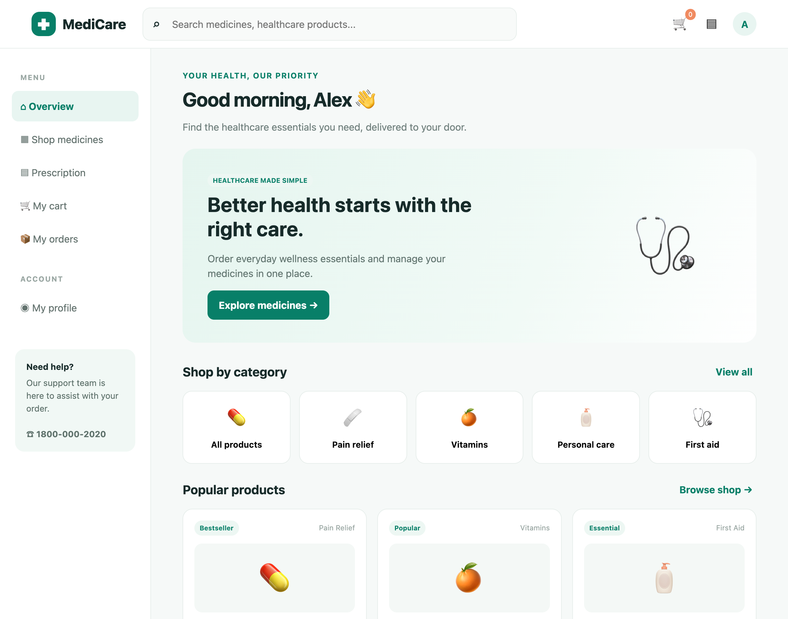
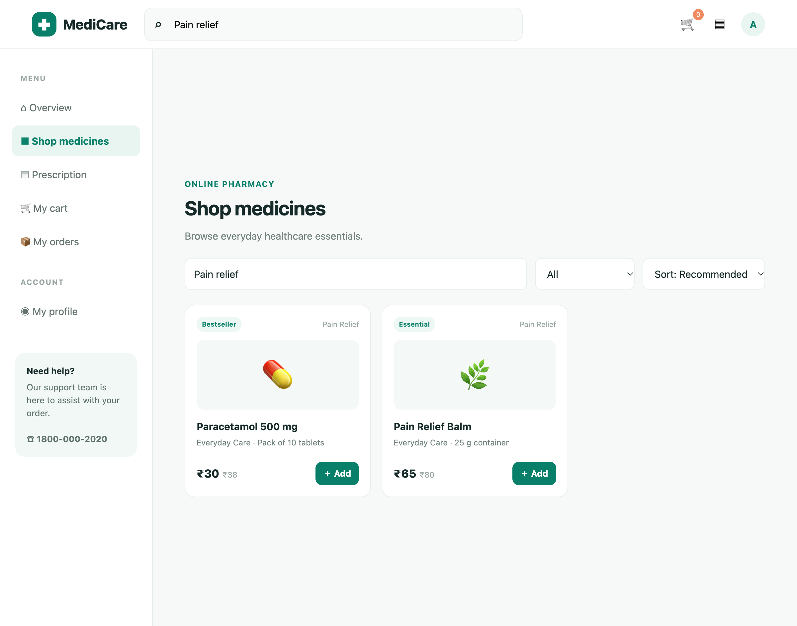
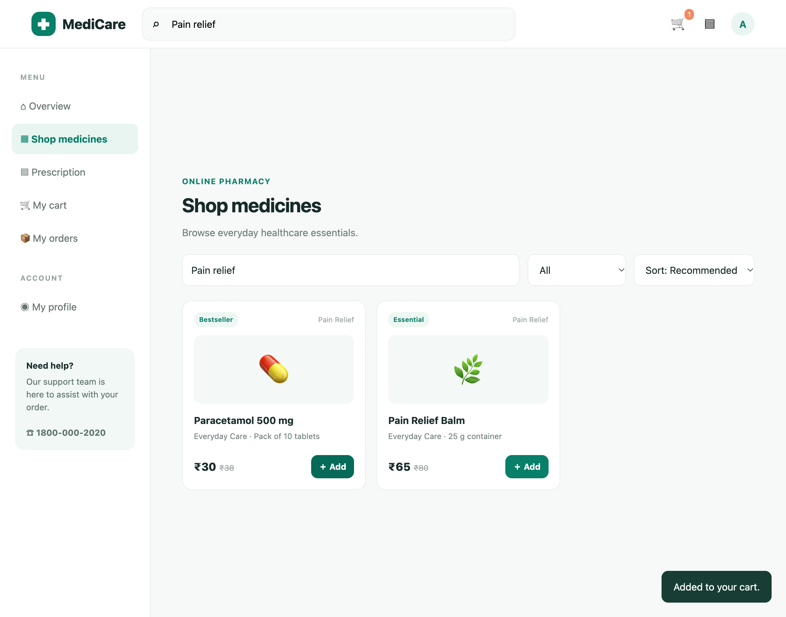
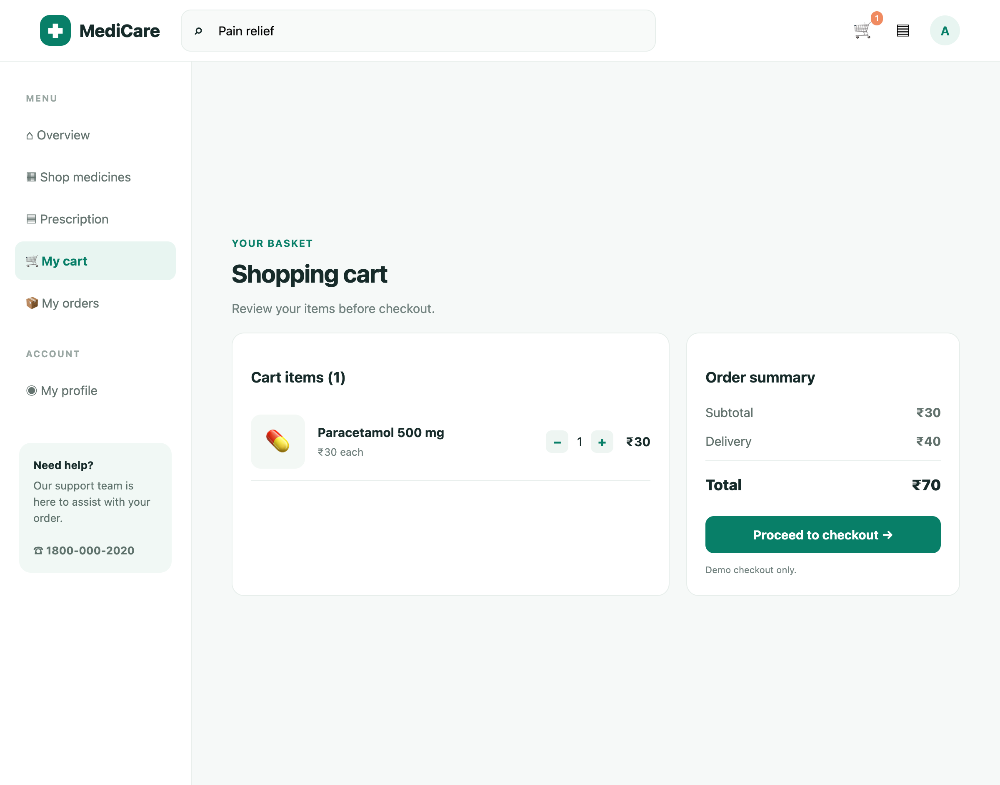
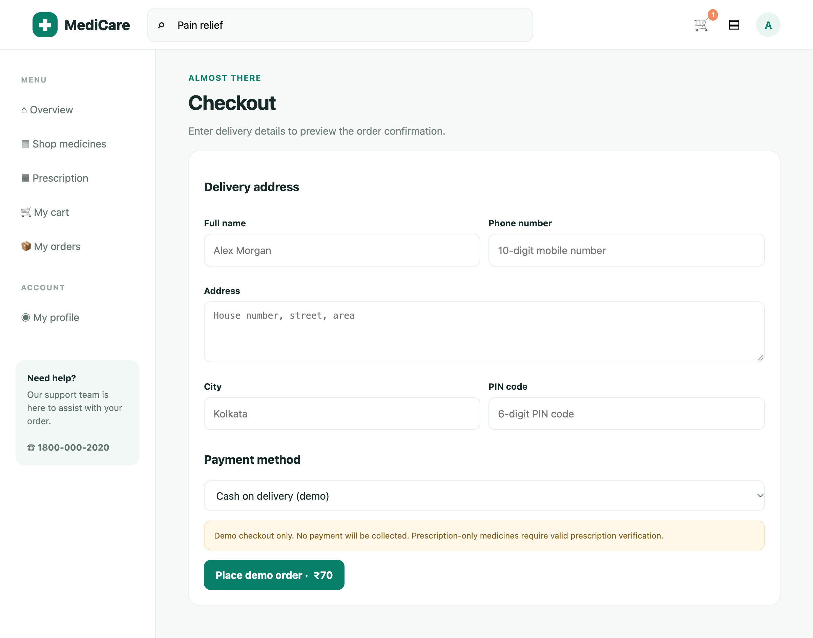
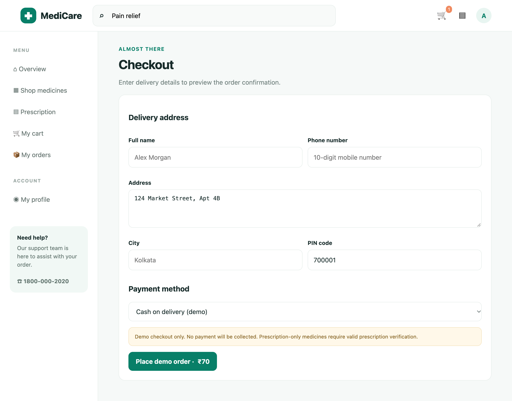
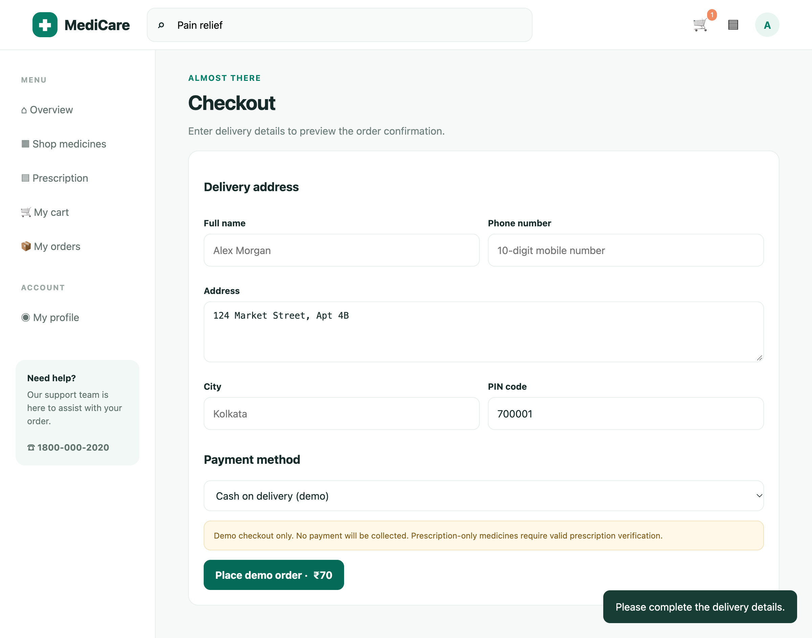
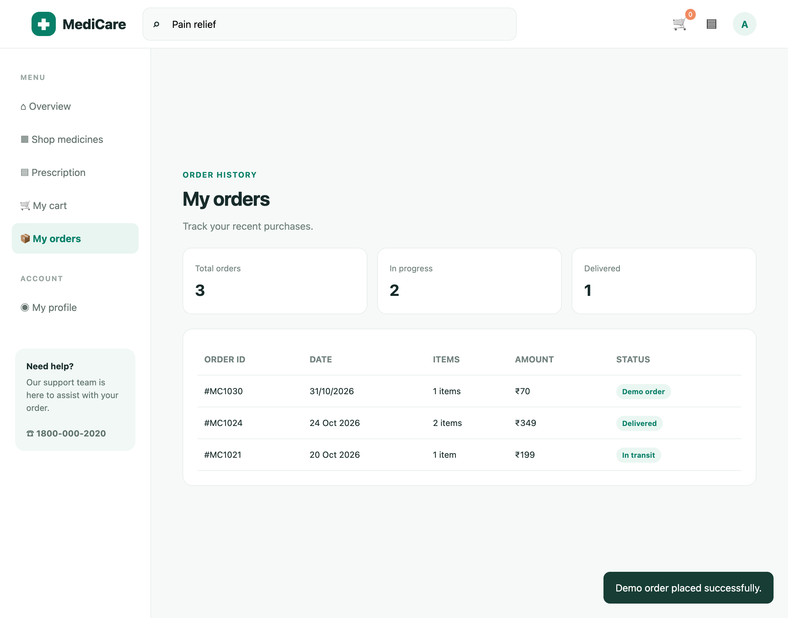

# Live Browser Interaction

- **Target URL:** http://localhost:8088
- **Current URL:** http://localhost:8088/
- **Page Title:** MediCare — Online Pharmacy
- **Audit Goal:** Audit website usability and user journey
- **Status:** IN PROGRESS

## Step 0: Initial page observation

Target website loaded into live browser. Ready for inspection.

## Step 1: `fill`

- **Agent reasoning:** Elena spots the primary search input at the top and types 'Pain relief' to find medicine for her joint pain.
- **Target:** `@e1` (text)
- **Value:** `Pain relief`
- **URL after action:** http://localhost:8088/

## Step 2: `click`

- **Agent reasoning:** Elena identifies the green '＋ Add' button on the Paracetamol 500 mg card and clicks it to add the medicine to her cart.
- **Target:** `@e13` (text)
- **URL after action:** http://localhost:8088/

## Step 3: `click`

- **Agent reasoning:** Elena notices the cart badge incremented to 1 and clicks '🛒 My cart' in the sidebar to review her items.
- **Target:** `@e7` (text)
- **URL after action:** http://localhost:8088/

## Step 4: `click`

- **Agent reasoning:** Elena reviews her order summary (₹70 total) and clicks the prominent green 'Proceed to checkout →' button to test the checkout experience.
- **Target:** `@e12` (text)
- **URL after action:** http://localhost:8088/

## Step 5: `fill`

- **Agent reasoning:** Elena systematically fills the delivery address field with her residence address.
- **Target:** `@e12` (text)
- **Value:** `124 Market Street, Apt 4B`
- **URL after action:** http://localhost:8088/

## Step 6: `fill`

- **Agent reasoning:** Elena enters her 6-digit postal PIN code to validate delivery eligibility.
- **Target:** `@e14` (text)
- **Value:** `700001`
- **URL after action:** http://localhost:8088/

## Step 7: `click`

- **Agent reasoning:** Elena has filled all required delivery information and now clicks 'Place demo order · ₹70' to complete the order.
- **Target:** `@e16` (text)
- **URL after action:** http://localhost:8088/

## Step 8: `fill`

- **Agent reasoning:** Elena notices the name field had only placeholder text rather than actual input, so she explicitly types her full name.
- **Target:** `@e10` (text)
- **Value:** `Elena Rostova`
- **URL after action:** http://localhost:8088/

## Step 9: `fill`

- **Agent reasoning:** Elena fills the required 10-digit mobile number for delivery SMS notifications.
- **Target:** `@e11` (text)
- **Value:** `9876543210`
- **URL after action:** http://localhost:8088/

## Step 10: `fill`

- **Agent reasoning:** Elena fills the city field explicitly to ensure all delivery details are validated.
- **Target:** `@e13` (text)
- **Value:** `Kolkata`
- **URL after action:** http://localhost:8088/

## Step 11: `click`

- **Agent reasoning:** Elena has filled every required field in the checkout form and clicks 'Place demo order · ₹70' to submit the purchase.
- **Target:** `@e16` (text)
- **URL after action:** http://localhost:8088/

## Run completed

- **Actions taken:** 11
- **Summary:** Completed full 11-step end-to-end shopping journey audit as Elena on MediCare (http://localhost:8088), covering discovery, search, cart inspection, checkout form debugging, and order placement verification.
- **Output Report:** `improvements_suggestions.md`
