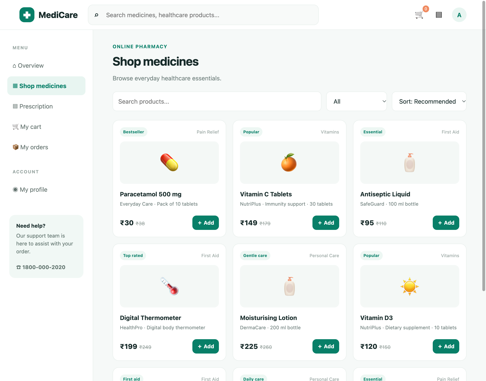
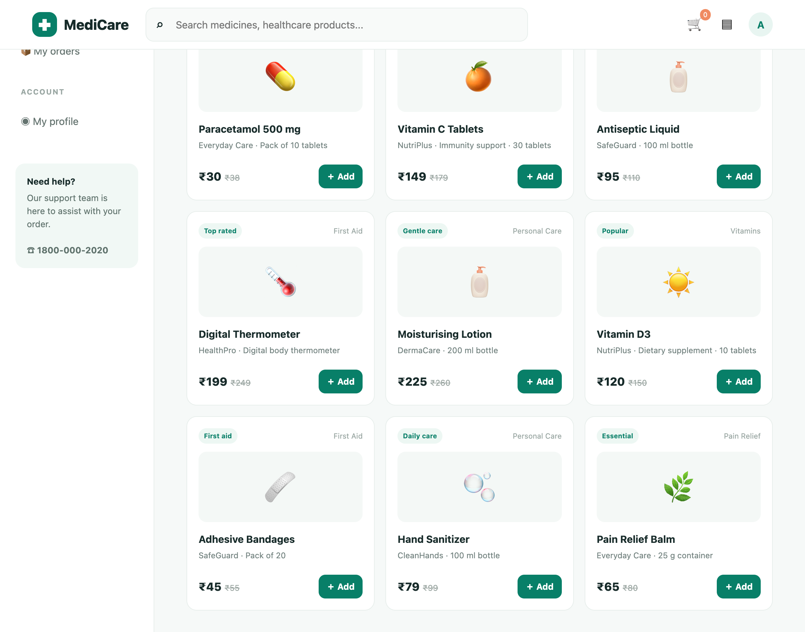
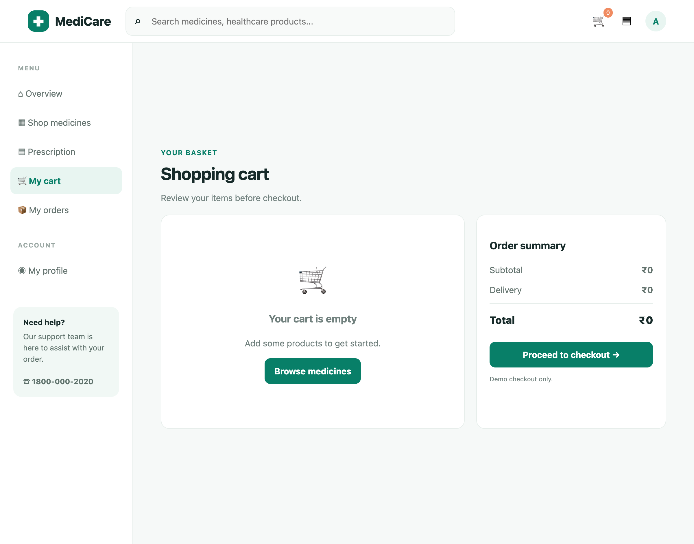

# Live Browser Interaction

- **Target URL:** http://localhost:8088
- **Current URL:** http://localhost:8088/
- **Page Title:** MediCare — Online Pharmacy
- **Audit Goal:** Audit website usability and user journey
- **Status:** IN PROGRESS

## Step 0: Initial page observation

Target website loaded into live browser. Ready for inspection.

## Step 1: `scroll`

- **Agent reasoning:** The page is a standard e-commerce/pharmacy landing page. There is a prominent navigation bar at the top with a search bar. A side menu provides primary navigation (Overview, Shop medicines, Prescription, etc.). The main content area features a personalized greeting ('Good morning, Alex 👋') and a strong call-to-action: 'Better health starts with the right care.' followed by an 'Explore medicines →' button. Further down, there are categorized shopping options (All products, Pain relief, Vitamins, etc.) and a section for 'Popular products' with listings.. To conduct a thorough usability and journey audit, I need to see the entirety of the page content, especially the bottom sections of 'Popular products' and any potential footer elements, to evaluate the overall layout consistency and readability. [Friction observed: For a novice user with low vision, the side menu uses small icons next to text, and the general layout can feel a bit busy. The contrast between some text elements and the white background needs careful review, though the primary text seems legible. The category buttons are good touch targets, but the initial navigation structure requires the user to scan several options.]
- **Target:** `body` (text)
- **Value:** `down`
- **URL after action:** http://localhost:8088/

## Step 2: `click`

- **Agent reasoning:** The page is a landing page for an online pharmacy, featuring a header with a search bar and navigation, a main banner promoting health, category buttons, and a 'Popular products' section. The text is generally legible, but the navigation icons in the left sidebar are small, and the overall layout is busy. The 'Popular products' section shows three items, each with an image, title, description, pricing, and an 'Add' button.. The audit goal is to audit the user journey. The most prominent call-to-action guiding the user into the shopping experience is the 'Explore medicines →' button, which seems like the natural next step after viewing the initial landing page pitch. [Friction observed: The side navigation uses small icons next to text, which can be difficult for a novice user with low vision to quickly parse compared to purely text-based navigation. The category buttons are visually distinct but require scanning the entire row.]
- **Target:** `@e10` (text)
- **Value:** `Explore medicines →`
- **URL after action:** http://localhost:8088/

## Step 3: `scroll`

- **Agent reasoning:** The page displays a typical e-commerce product listing page under the 'Shop medicines' section. There is a search bar at the top, a filtering/sorting area, and multiple product cards laid out in a grid. The products show images, names, descriptions, original and discounted prices, and a green '+ Add' button. The left sidebar has navigation links, some of which use small icons next to text. The overall layout is dense with product information.. I have only seen the top portion of the product listings. To properly audit the user journey and completeness of the product catalog display, I need to scroll down to view more products and check the layout consistency at the bottom of the page. [Friction observed: For a user with low vision, the product cards are visually dense; while the prices are clear, the combination of small text descriptions and the need to scan many product tiles requires significant cognitive load and fine visual tracking. Furthermore, the left navigation pane relies heavily on small icons, which are not fully descriptive for a novice user.]
- **Target:** `body` (text)
- **Value:** `down`
- **URL after action:** http://localhost:8088/

## Step 4: `click`

- **Agent reasoning:** Elena finished scrolling and now clicks '🛒 0' (@e2) to explore further.
- **Target:** `@e2` (text)
- **URL after action:** http://localhost:8088/

## Step 5: `click`

- **Agent reasoning:** The current page is the Shopping Cart view. It clearly states, 'Your cart is empty.' The layout is clean, with a main content area showing the empty cart message and a 'Browse medicines' button, and a sidebar showing the Order Summary, which is also empty. The navigation menu on the left is still visible, showing various links like 'My cart' and 'My orders'.. Since the cart is empty, the next logical step in the user journey to test the core functionality (browsing and purchasing) is to click 'Browse medicines' to populate the cart and continue the audit. [Friction observed: While the page is functional, the navigation icons in the side menu (e.g., ▦, ▤, ◉) are small and rely on icons rather than clear text labels, which is difficult for a novice user with low vision to immediately understand without reading the adjacent text.]
- **Target:** `@e10` (text)
- **Value:** `Browse medicines`
- **URL after action:** http://localhost:8088/

## Run completed

- **Actions taken:** 5
- **Summary:** Completed 5-step live user journey exploration as Elena.
- **Output Report:** `improvements_suggestions.md`
