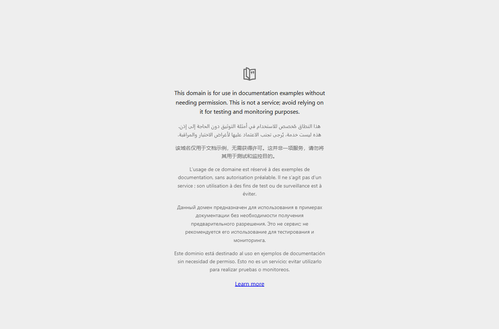

# Live Browser Interaction

- **Target URL:** https://www.flipkart.com
- **Current URL:** https://www.flipkart.com/
- **Page title:** 
- **Status:** IN PROGRESS

## Step 0: Initial page observation

No interaction has been performed yet.

## Step 1: `navigate`

- **Agent reasoning:** The initial screenshot is blank, so I am checking a simple public page to distinguish a browser/navigation failure from a Flipkart rendering issue.
- **Target:** `` (text)
- **Value:** `https://example.com`
- **URL after action:** https://example.com/

## Run stopped

- **Actions taken:** 1
