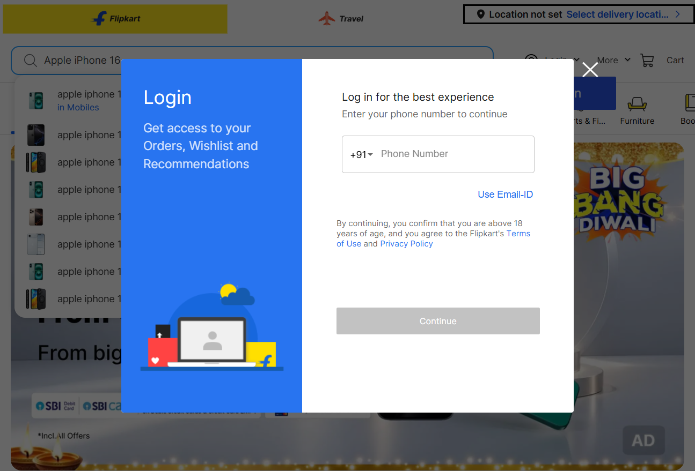
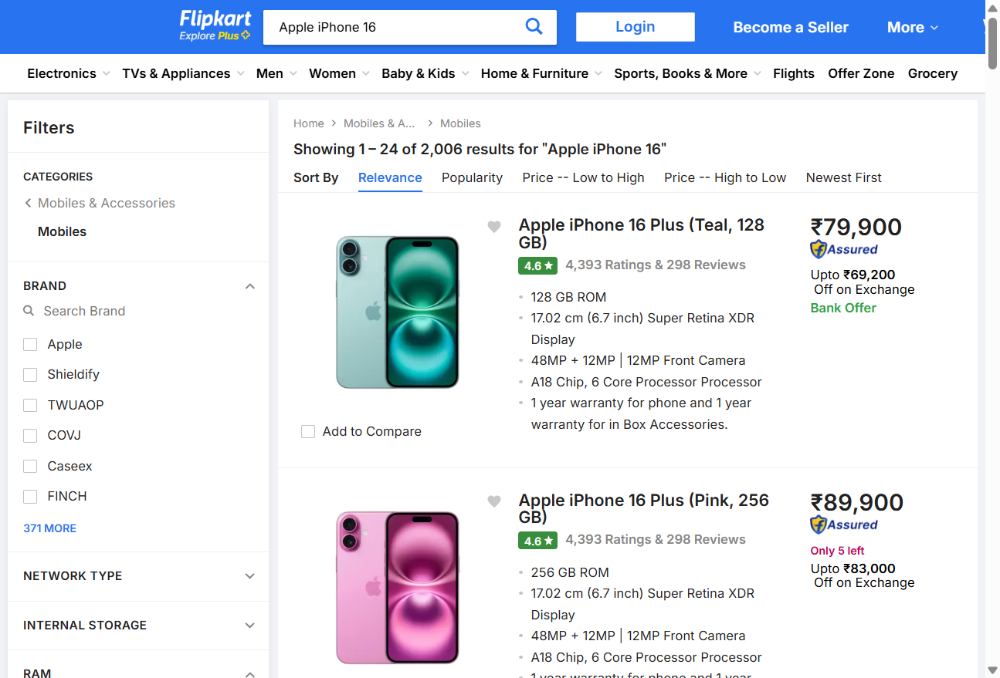
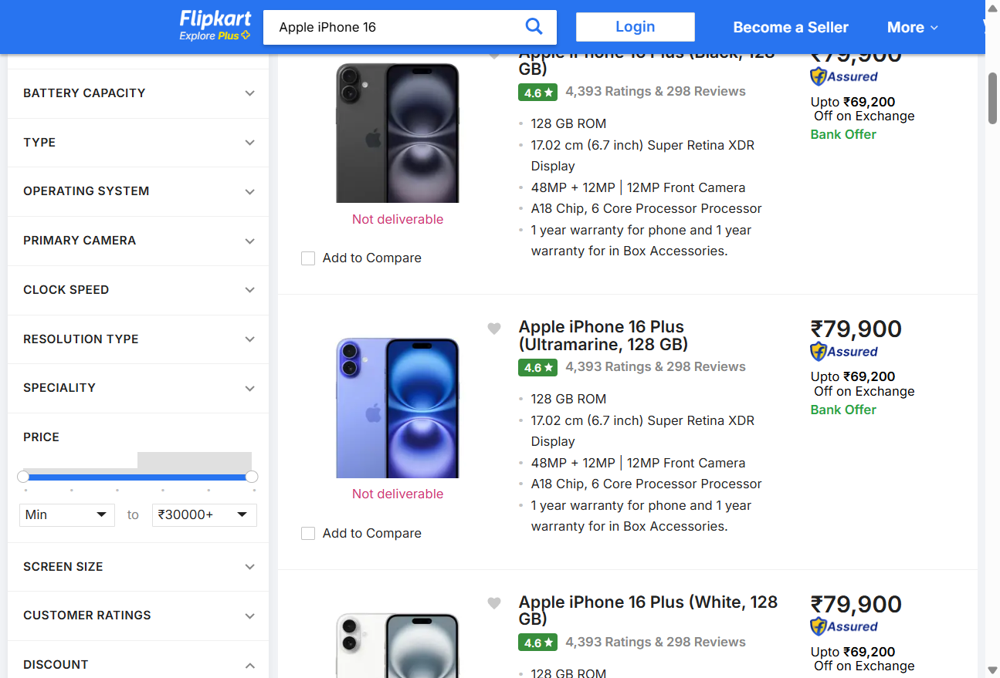
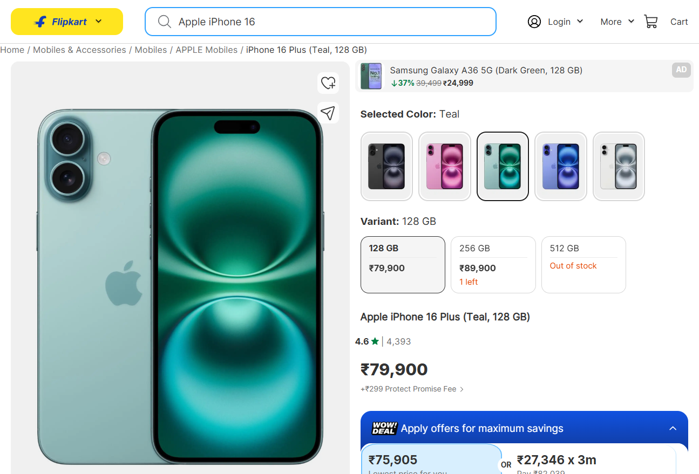

# Live Browser Interaction

- **Target URL:** https://www.flipkart.com
- **Current URL:** https://www.flipkart.com/
- **Page title:** Online Shopping Site for Mobiles, Electronics, Furniture, Grocery, Lifestyle, Books & More. Best Offers!
- **Status:** IN PROGRESS

## Step 0: Initial page observation

No interaction has been performed yet.

## Step 1: `fill`

- **Agent reasoning:** Enter product query 'Apple iPhone 16' into central search bar to discover product listings.
- **Target:** `@e3` (ref)
- **Value:** `Apple iPhone 16`
- **URL after action:** https://www.flipkart.com/

## Step 2: `press`

- **Agent reasoning:** Submit search form to navigate to catalog search results.
- **Target:** `@e3` (ref)
- **Value:** `Enter`
- **URL after action:** https://www.flipkart.com/search?q=Apple%20iPhone%2016&otracker=search&otracker1=search&marketplace=FLIPKART&as-show=on&as=off

## Step 3: `scroll`

- **Agent reasoning:** Scroll catalog down by 750px to view primary product cards, ratings, and price tags.
- **Target:** `` (text)
- **URL after action:** https://www.flipkart.com/search?q=Apple%20iPhone%2016&otracker=search&otracker1=search&marketplace=FLIPKART&as-show=on&as=off

## Step 4: `click`

- **Agent reasoning:** Click product title to view the full specification sheet, storage options, and add-to-cart controls.
- **Target:** `@e20` (ref)
- **URL after action:** https://www.flipkart.com/apple-iphone-16-plus-teal-128-gb/p/itmfa939eebe8adf?pid=MOBH4DQFEUZVMK6G&lid=LSTMOBH4DQFEUZVMK6GOZPF2R&marketplace=FLIPKART&q=Apple+iPhone+16&store=tyy%2F4io&srno=s_1_1&otracker=search&otracker1=search&fm=organic&iid=4aa249f7-f922-4d5c-ab81-ac1854c8059e.MOBH4DQFEUZVMK6G.SEARCH&ppt=dynamic&ppn=Login%3ACategory_List&ssid=xqh6wzuojk0000001793341516621&qH=cf9fd4020bc657e4&ov_redirect=true

## Run completed

- **Actions taken:** 4
