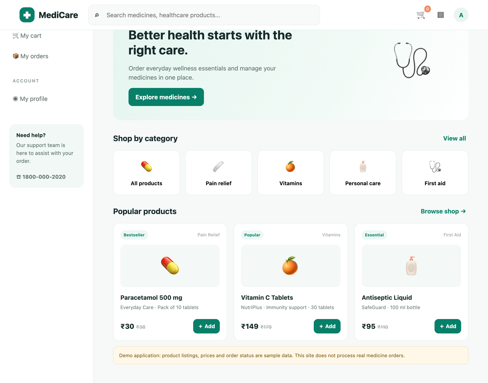
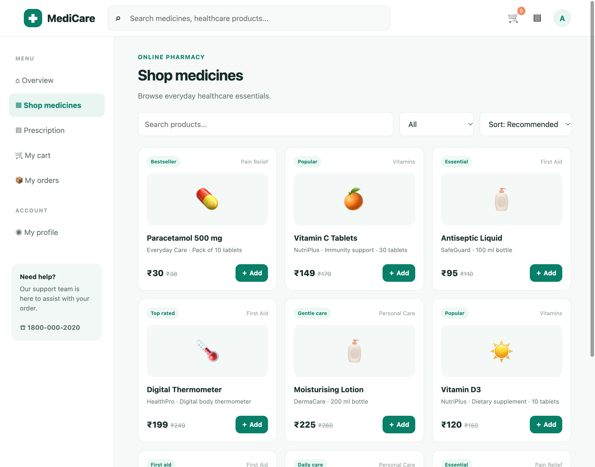
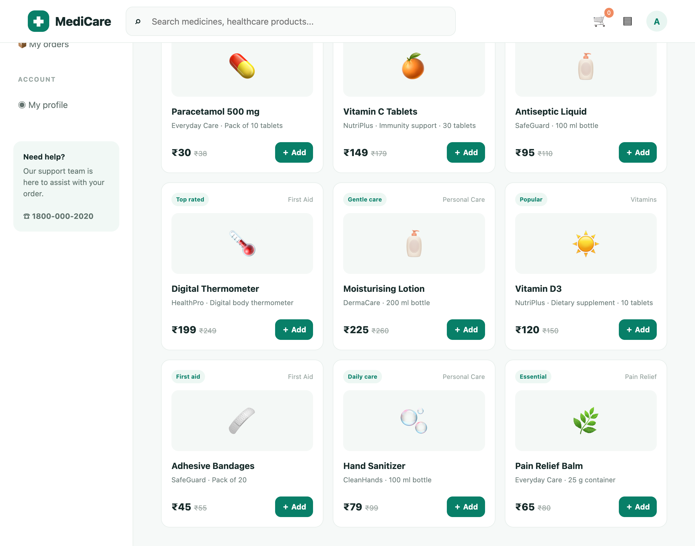
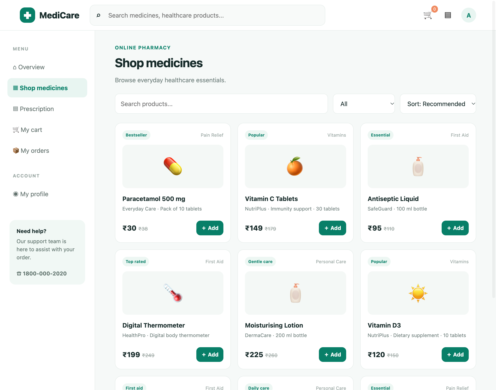

# Live Browser Interaction

- **Target URL:** http://localhost:8088
- **Current URL:** http://localhost:8088/
- **Page Title:** MediCare — Online Pharmacy
- **Audit Goal:** Audit website usability and user journey
- **Status:** IN PROGRESS

## Step 0: Initial page observation

Target website loaded into live browser. Ready for inspection.

## Step 1: `scroll`

- **Agent reasoning:** The page is the homepage of MediCare. It features a prominent search bar at the top. The navigation menu on the left is clear but uses small text and icons. The main content area has a large promotional banner ('Good morning, Alex 👋') followed by product categories presented as clickable tiles (e.g., 'All products', 'Pain relief'). Below this are 'Popular products' displayed in a horizontal scrollable section.. To thoroughly audit the user journey, I need to see the entire page content, especially the full listing of 'Popular products' and any content below the fold, to evaluate the layout and readability of the product cards. [Friction observed: For a low-vision user, the small font sizes in the navigation menu and the general density of information, especially the small text labels on the category tiles, could cause significant visual strain. The contrast seems generally acceptable for text on white, but the icons in the navigation are small.]
- **Target:** `body` (text)
- **Value:** `down`
- **URL after action:** http://localhost:8088/

## Step 2: `click`

- **Agent reasoning:** The page is the homepage of MediCare. It has a header with a search bar and navigation icons. The main area features a large promotional banner ('Better health starts with the right care.') followed by category tiles ('All products', 'Pain relief', 'Vitamins', etc.). Below that are 'Popular products' displayed in cards. The navigation menu on the left has small text links ('My cart', 'My orders', 'My profile').. The current goal is to audit the user journey. Since the homepage provides a high-level overview, clicking the prominent 'Explore medicines →' button seems like the most logical next step to move deeper into the site's content and evaluate the product browsing experience, which is critical for an online pharmacy. [Friction observed: The navigation links on the left sidebar use very small font sizes, which is difficult for a low-vision user to read clearly. The category tiles, while visually distinct, use small text labels.]
- **Target:** `@e10` (text)
- **Value:** `None`
- **URL after action:** http://localhost:8088/

## Step 3: `scroll`

- **Agent reasoning:** The page displays an online pharmacy interface. The left sidebar has navigation links (Overview, Shop medicines, Prescription, My cart, My orders, My profile) with small text. The main area is titled 'Shop medicines' and shows several product cards arranged in a grid/list format, each featuring an image, product name, price, and an 'Add' button. There are search bars and filter/sort dropdowns above the product listings. The font sizes across the interface, particularly in the sidebar and product descriptions, appear small.. To thoroughly audit the user journey and product browsing experience, I need to see all the available products and content below the fold to assess overall layout consistency and readability, especially given the existing small text size issues. [Friction observed: The font size in the left navigation menu is very small, posing a significant readability challenge for a low-vision user. Also, the product card text (e.g., 'Everyday Care · Pack of 10 tablets') is dense and small.]
- **Target:** `body` (text)
- **Value:** `down`
- **URL after action:** http://localhost:8088/

## Step 4: `click`

- **Agent reasoning:** The screen is a product listing page titled 'Shop medicines'. It features a main content area displaying various product cards in a grid format. The left sidebar contains navigation links with small text. Above the products, there are dropdowns for filtering ('All Pain Relief Vitamins Personal Care First Aid') and sorting. The product information (name, description, price) is present but the text size appears small across the board.. To continue auditing the user journey, I need to test the filtering functionality to see how the interface handles selection changes. Clicking the current filter dropdown (@e11) is the most logical next step to explore the product discovery path beyond just scrolling. [Friction observed: The font size in the left navigation menu and the small text labels on the product cards create significant visual strain and difficulty for low-vision users. The dropdown menus (@e11, @e12) are functional but require precise interaction.]
- **Target:** `@e11` (text)
- **Value:** `None`
- **URL after action:** http://localhost:8088/

## Step 5: `click`

- **Agent reasoning:** The screen shows a product listing page for 'Shop medicines'. There is a left navigation sidebar with small text links. The main area features product cards (e.g., Paracetamol, Vitamin C) with prices and 'Add' buttons. Above the products, there are filter dropdowns ('@e11') and sort dropdowns ('@e12'). The overall text size across the interface, especially in the navigation and product descriptions, appears very small.. I have already scrolled and noted the small text. To continue the audit of the user journey and product browsing, I need to test the filtering mechanism. Clicking the filter dropdown ('@e11') is the logical next step to see how filtering options appear and if they are accessible. [Friction observed: The primary friction for a low-vision user is the extremely small font size used throughout the interface, particularly in the side navigation and product details, making reading difficult and causing significant visual strain.]
- **Target:** `@e11` (text)
- **Value:** `None`
- **URL after action:** http://localhost:8088/

## Run completed

- **Actions taken:** 5
- **Summary:** Completed 5-step live user journey exploration as Elena.
- **Output Report:** `improvements_suggestions.md`
