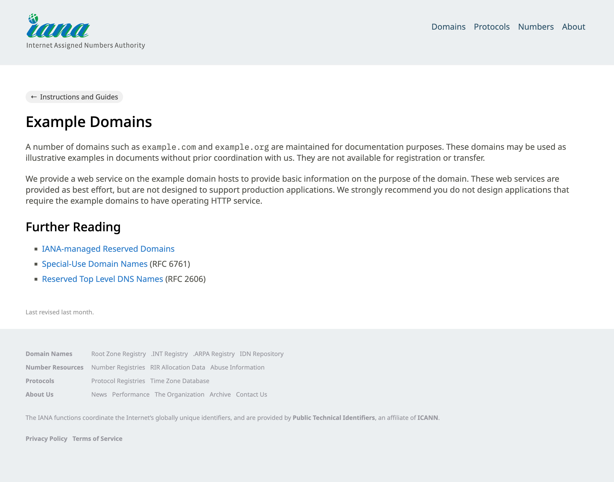
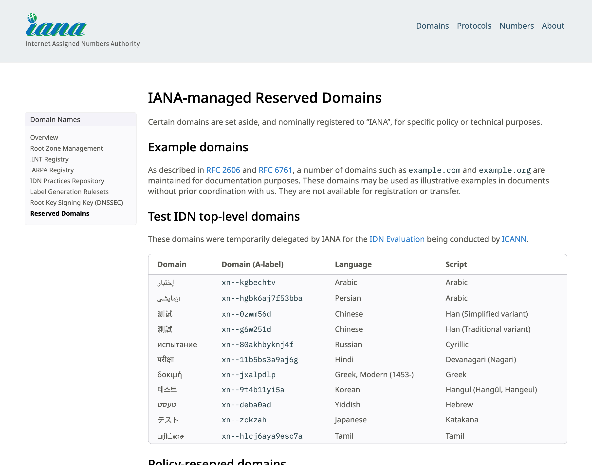
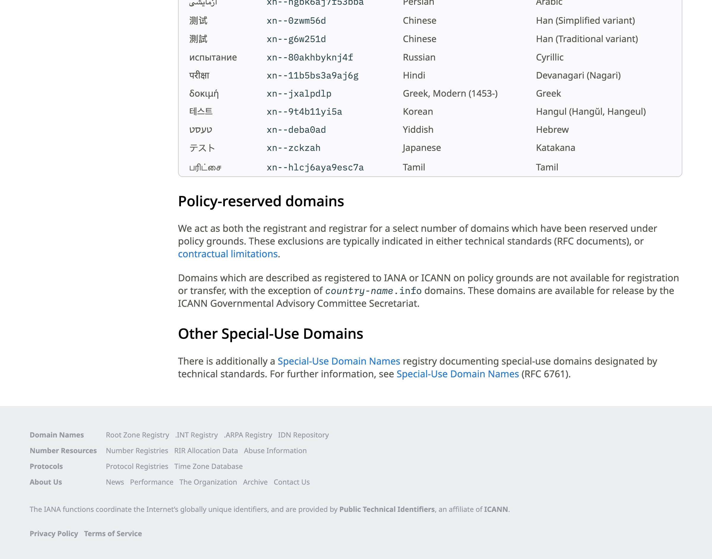

# Live Browser Interaction

- **Target URL:** https://example.com
- **Current URL:** https://example.com/
- **Page Title:** Example Domain
- **Audit Goal:** Audit website usability and user journey
- **Status:** IN PROGRESS

## Step 0: Initial page observation

Target website loaded into live browser. Ready for inspection.

## Step 1: `click`

- **Agent reasoning:** Elena navigates forward by clicking the primary 'Learn more' link to reach the documentation destination.
- **Target:** `@e1` (text)
- **URL after action:** https://www.iana.org/help/example-domains

## Step 2: `click`

- **Agent reasoning:** Elena clicks 'IANA-managed Reserved Domains' under Further Reading to explore specific reserved domain policies.
- **Target:** `@e7` (text)
- **URL after action:** https://www.iana.org/domains/reserved

## Step 3: `scroll`

- **Agent reasoning:** Elena scrolls down to inspect the policy table, table headers, and lower page layout.
- **Target:** `window` (text)
- **Value:** `400`
- **URL after action:** https://www.iana.org/domains/reserved

## Run completed

- **Actions taken:** 3
- **Summary:** Completed live interactive inspection journey across Example Domain and IANA documentation. Identified 3 concrete evidence-backed UX improvements for senior/low-vision users.
- **Output Report:** `improvements_suggestions.md`
