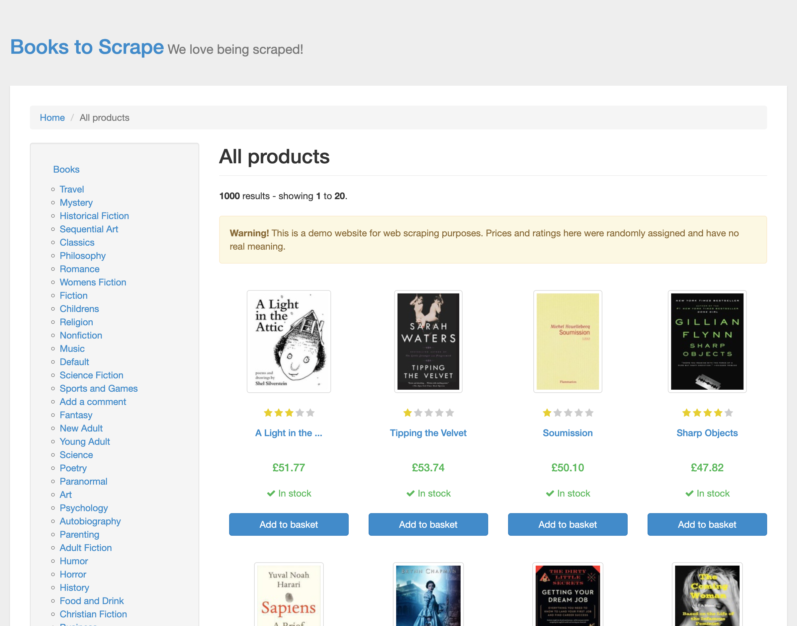
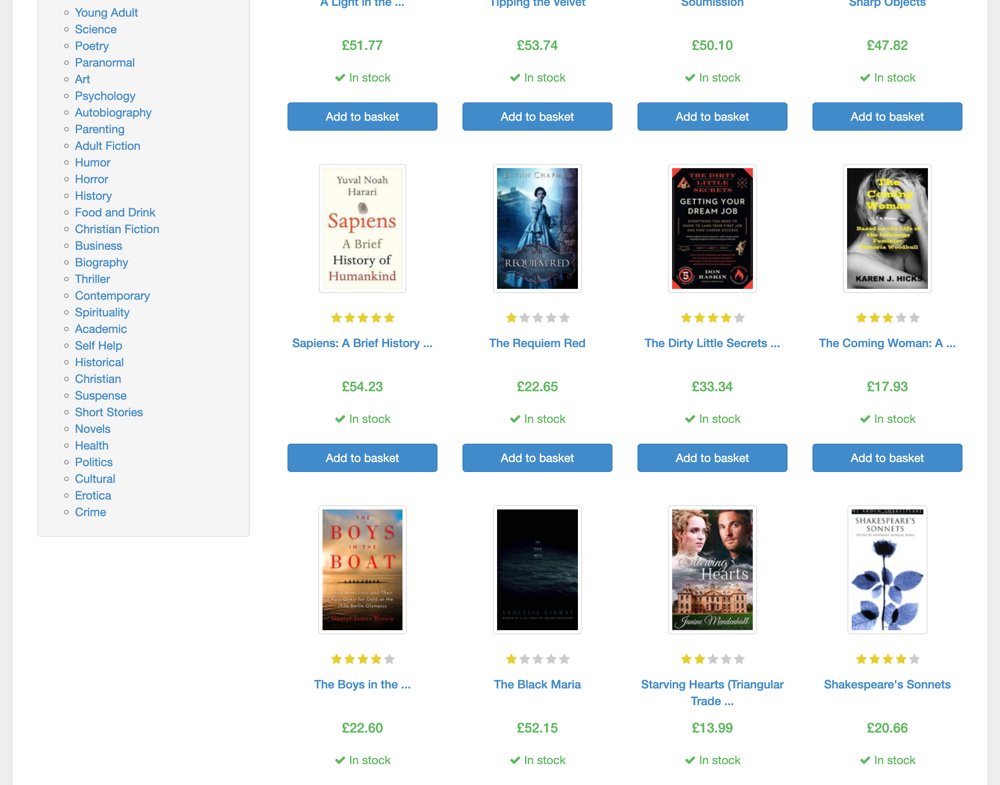
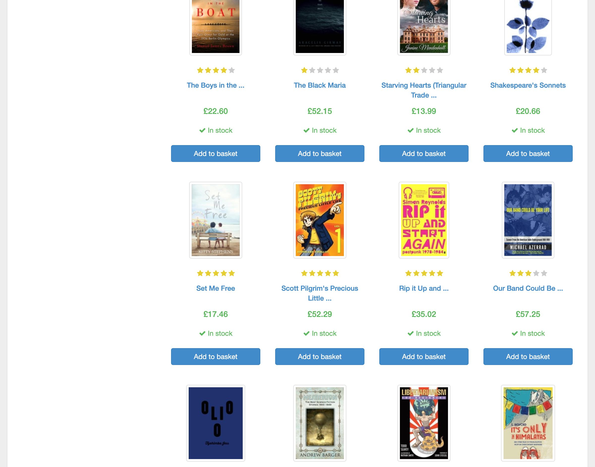
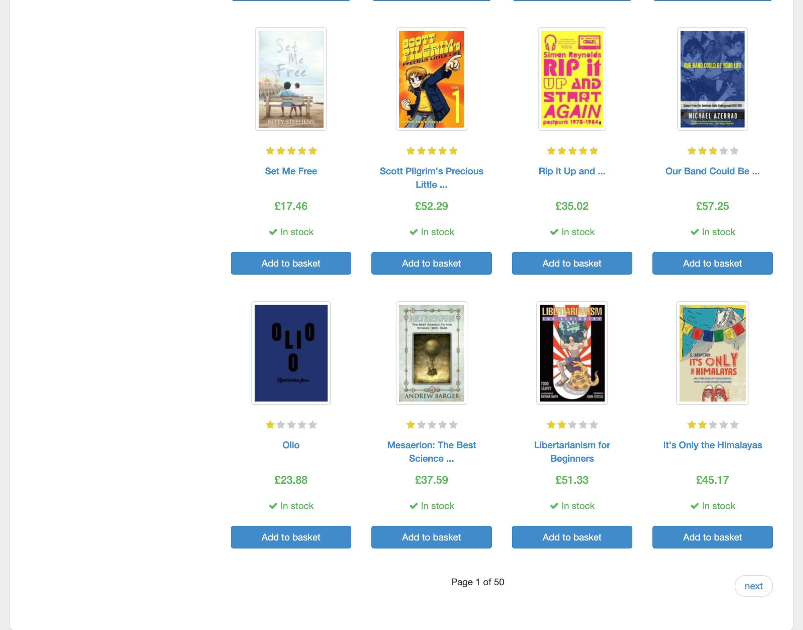

# Live Browser Interaction

- **Target URL:** https://books.toscrape.com
- **Current URL:** https://books.toscrape.com/
- **Page Title:** All products | Books to Scrape - Sandbox
- **Audit Goal:** Audit website usability and user journey
- **Status:** IN PROGRESS

## Step 0: Initial page observation

Target website loaded into live browser. Ready for inspection.

## Step 1: `scroll`

- **Agent reasoning:** The product listings are visible, but I cannot see all the products or the bottom of the page clearly. Since I need to follow the main user journey, I will scroll down to see more products and check for page navigation controls, which is important for a novice user.
- **Target:** `document` (text)
- **Value:** `down`
- **URL after action:** https://books.toscrape.com/

## Step 2: `scroll`

- **Agent reasoning:** The page has a lot of content, and I need to scroll down to see all the available books and options, as the initial view is quite dense. Scrolling will help me get a better overview of the products available.
- **Target:** `body` (text)
- **Value:** `down`
- **URL after action:** https://books.toscrape.com/

## Step 3: `scroll`

- **Agent reasoning:** As someone with low vision, I need to see all the products available on this page. I will scroll down to examine the entire selection, as the current view only shows a small portion of the items.
- **Target:** `document` (text)
- **Value:** `down`
- **URL after action:** https://books.toscrape.com/

## Step 4: `scroll`

- **Agent reasoning:** The page displays many products, but I need to see more to browse. I will scroll down to check for more options and see the full extent of the product listing, ensuring I don't miss anything.
- **Target:** `document` (text)
- **Value:** `down`
- **URL after action:** https://books.toscrape.com/

## Run completed

- **Actions taken:** 4
- **Summary:** Completed 4-step live user journey exploration as Elena.
- **Output Report:** `improvements_suggestions.md`
