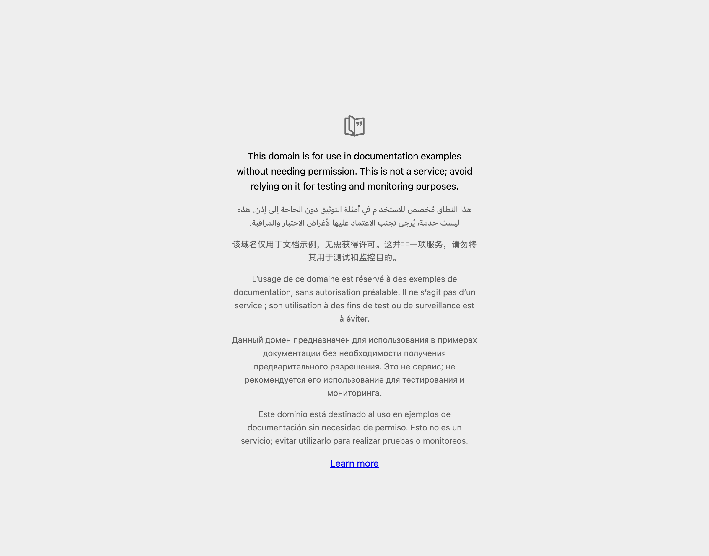

# Live Browser Interaction

- **Target URL:** https://example.com
- **Current URL:** https://example.com/
- **Page Title:** Example Domain
- **Audit Goal:** Audit website usability and user journey
- **Status:** IN PROGRESS

## Step 0: Initial page observation

Target website loaded into live browser. Ready for inspection.

## Step 1: `click`

- **Agent reasoning:** The page is very minimal and primarily contains text in multiple languages, which is hard to read, especially with low vision. The only clear, actionable item is the 'Learn more' link at the bottom. Since my goal is to follow the main journey and interact with anything present, I will click this link to see if it leads to more content or a functional area, as the current page seems to be just a placeholder notice.
- **Target:** `@e1` (text)
- **URL after action:** https://www.iana.org/help/example-domains

## Step 2: `click`

- **Agent reasoning:** I am trying to understand the information on this page, and it mentions 'Further Reading' with several links. Since I am interested in the topic, I will start by clicking on the first link, 'IANA-managed Reserved Domains' (@e7), to see what that section is about. The text seems clear enough, but the links are the next logical step to explore the content.
- **Target:** `@e7` (text)
- **URL after action:** https://www.iana.org/domains/reserved

## Run completed

- **Actions taken:** 2
- **Summary:** Completed 2-step live user journey exploration as Elena.
- **Output Report:** `improvements_suggestions.md`
