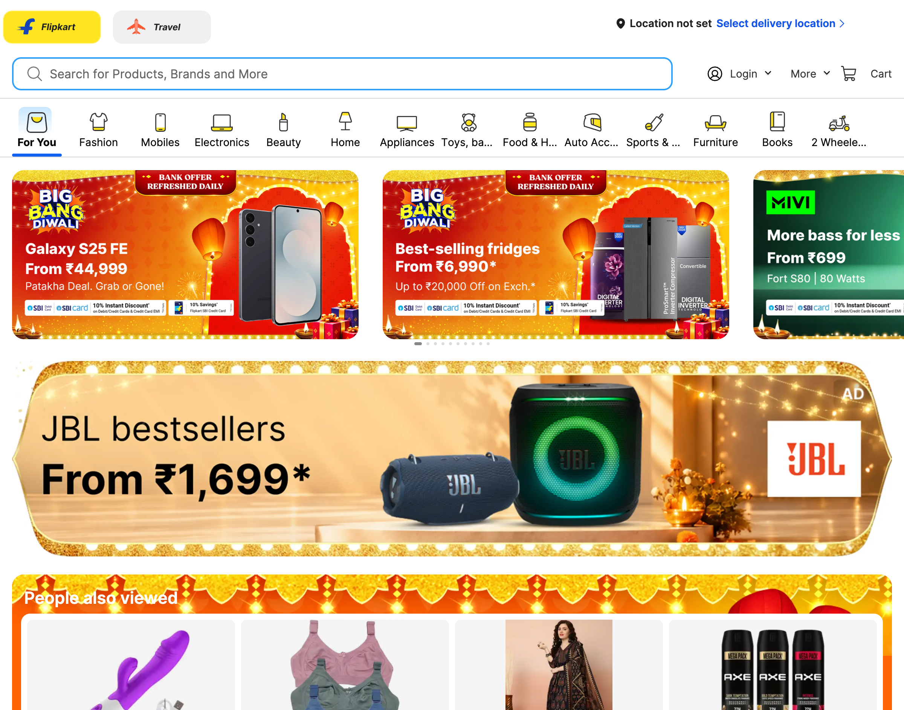
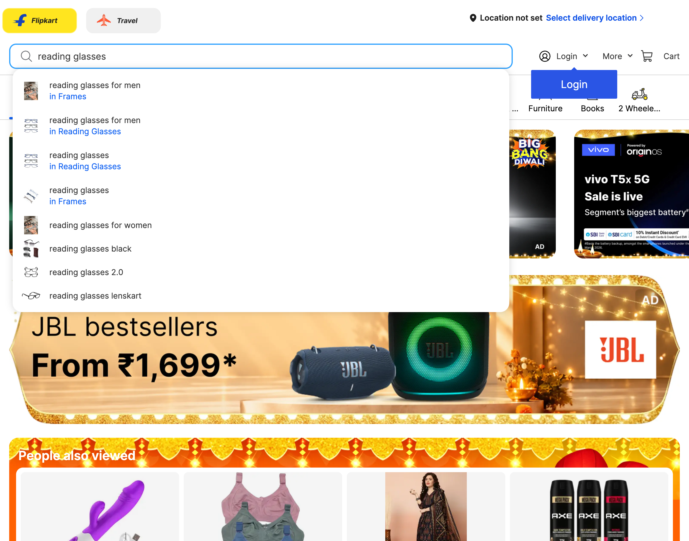
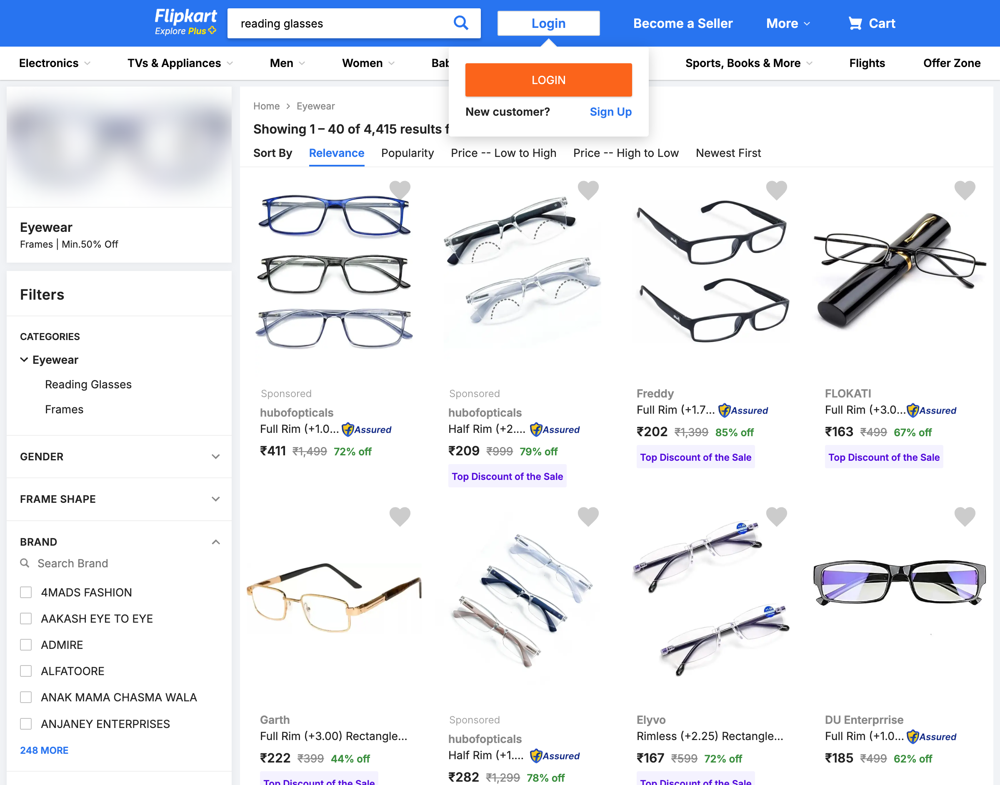
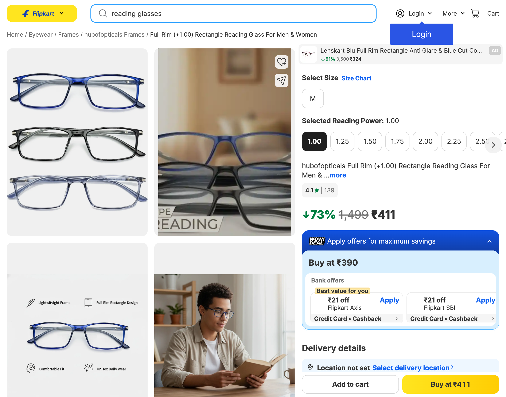
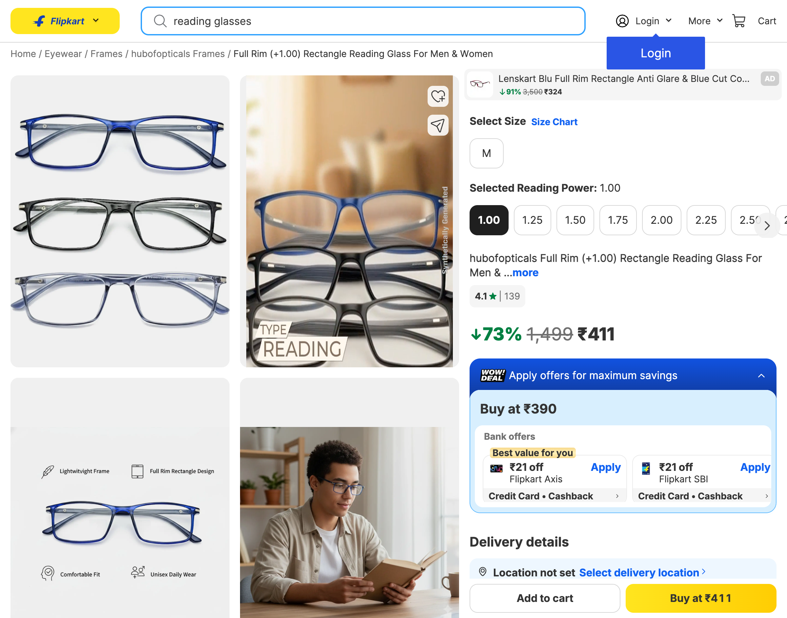
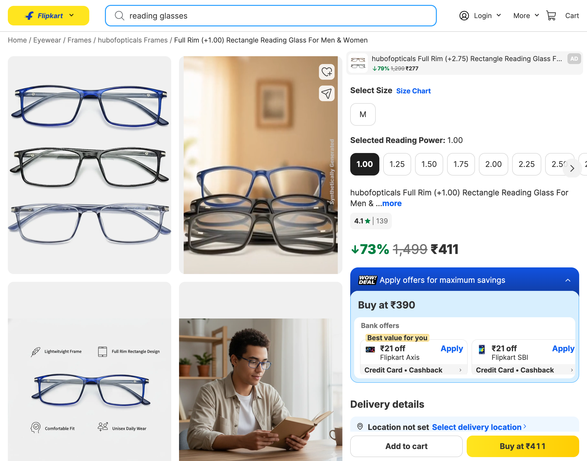

# Live Browser Interaction

- **Target URL:** https://www.flipkart.com
- **Current URL:** https://www.flipkart.com/
- **Page Title:** Online Shopping Site for Mobiles, Electronics, Furniture, Grocery, Lifestyle, Books & More. Best Offers!
- **Audit Goal:** Audit website usability and user journey
- **Status:** IN PROGRESS

## Step 0: Initial page observation

Target website loaded into live browser. Ready for inspection.

## Step 1: `fill`

- **Agent reasoning:** As a novice user with low vision, I need to search for something specific, like 'reading glasses', rather than trying to navigate the many categories. I will type the search term into the large search bar first.
- **Target:** `@e3` (text)
- **Value:** `reading glasses`
- **URL after action:** https://www.flipkart.com/

## Step 2: `press`

- **Agent reasoning:** Elena finished typing the search query and now presses 'Enter' to view search results.
- **Target:** `@e3` (text)
- **Value:** `Enter`
- **URL after action:** https://www.flipkart.com/search?q=reading%20glasses&otracker=search&otracker1=search&marketplace=FLIPKART&as-show=on&as=off

## Step 3: `click`

- **Agent reasoning:** I have searched for 'reading glasses' and now I see many products. Since I need to look closely at the glasses, I will click on the first product listing, which appears to be a pair of reading glasses, to see more details. I need to check the size and options before buying.
- **Target:** `@e21` (text)
- **Value:** `None`
- **URL after action:** https://www.flipkart.com/hubofopticals-full-rim-1-00-rectangle-reading-glasses/p/itm5574f363cbb94?pid=FRAHJ9YHUS5BPZJR&lid=LSTFRAHJ9YHUS5BPZJRPMQKUH&marketplace=FLIPKART&q=reading+glasses&store=u73&srno=s_1_1&otracker=search&otracker1=search&fm=organic&iid=en_x1fJVGmMg2URykUExzlwDiSICq1lBqoTjhulHl1mRsa4OcKKlKKU04s4S5sCZBwWWOiE1eMCTK8bDnVfmWW2b4eCWCj-3VQ12FoE59RTq8HdAxV4N3uCHyHijfZDITB8&ppt=dynamic&ppn=Login%3ACategory_List&ssid=n4hsgtu6340000001793441956161&qH=5b7f24f91b720ebb&ov_redirect=true

## Step 4: `click`

- **Agent reasoning:** I am looking at reading glasses, and the product details page shows several reading power options. Since the product title suggests (+1.00), and this is the default/selected option, I will click '1.00' to ensure this specific power is selected before proceeding to buy. The button is large and clearly labeled, which is good for my vision.
- **Target:** `@e19` (text)
- **Value:** `1.00`
- **URL after action:** https://www.flipkart.com/hubofopticals-full-rim-1-00-rectangle-reading-glasses/p/itm5574f363cbb94?pid=FRAHJ9YHUS5BPZJR&lid=LSTFRAHJ9YHUS5BPZJRPMQKUH&marketplace=FLIPKART&q=reading+glasses&store=u73&srno=s_1_1&otracker=search&otracker1=search&fm=organic&iid=en_x1fJVGmMg2URykUExzlwDiSICq1lBqoTjhulHl1mRsa4OcKKlKKU04s4S5sCZBwWWOiE1eMCTK8bDnVfmWW2b4eCWCj-3VQ12FoE59RTq8HdAxV4N3uCHyHijfZDITB8&ppt=dynamic&ppn=Login%3ACategory_List&ssid=n4hsgtu6340000001793441956161&qH=5b7f24f91b720ebb&ov_redirect=true

## Step 5: `click`

- **Agent reasoning:** I see the product details page for the reading glasses. My low vision requires clear options. The reading power '1.00' is currently selected, and since this is the default or the one I was looking at, I will confirm this selection by clicking it, although it appears to be active. Next, I need to decide whether to add it to the cart or buy it immediately. Given my novice tech skills, I will proceed to the purchase options at the bottom of the screen. However, first, I must ensure the required settings are correct. Since '1.00' is selected, I will proceed to the next logical step, which is to click 'Buy at ₹411' to complete the purchase, as this is the most direct path.
- **Target:** `@e19` (text)
- **Value:** `1.00`
- **URL after action:** https://www.flipkart.com/hubofopticals-full-rim-1-00-rectangle-reading-glasses/p/itm5574f363cbb94?pid=FRAHJ9YHUS5BPZJR&lid=LSTFRAHJ9YHUS5BPZJRPMQKUH&marketplace=FLIPKART&q=reading+glasses&store=u73&srno=s_1_1&otracker=search&otracker1=search&fm=organic&iid=en_x1fJVGmMg2URykUExzlwDiSICq1lBqoTjhulHl1mRsa4OcKKlKKU04s4S5sCZBwWWOiE1eMCTK8bDnVfmWW2b4eCWCj-3VQ12FoE59RTq8HdAxV4N3uCHyHijfZDITB8&ppt=dynamic&ppn=Login%3ACategory_List&ssid=n4hsgtu6340000001793441956161&qH=5b7f24f91b720ebb&ov_redirect=true

## Run completed

- **Actions taken:** 5
- **Summary:** Completed 5-step live user journey exploration as Elena.
- **Output Report:** `improvements_suggestions.md`
