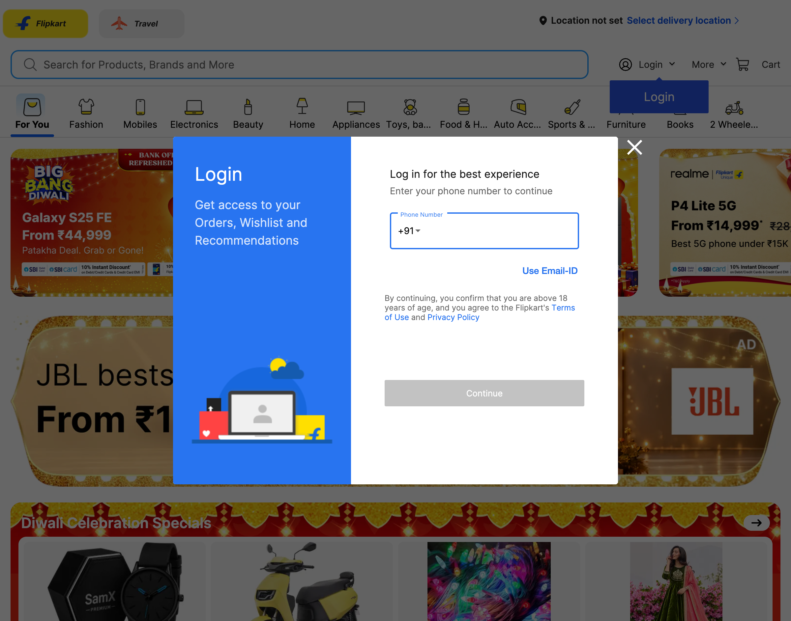
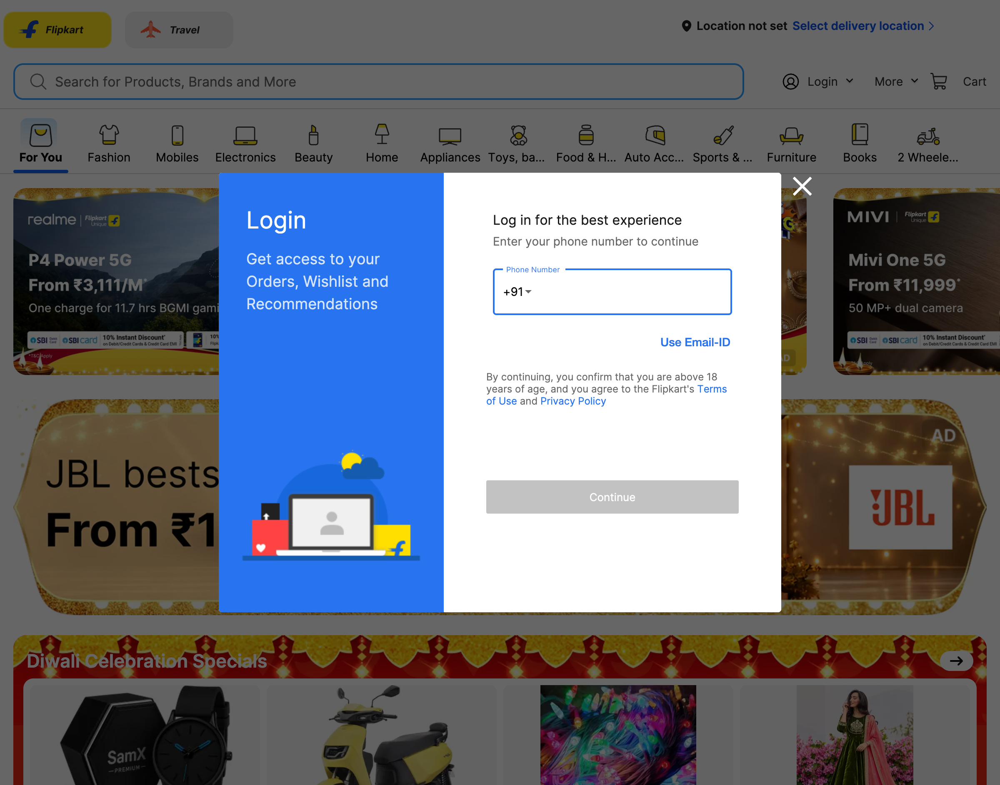
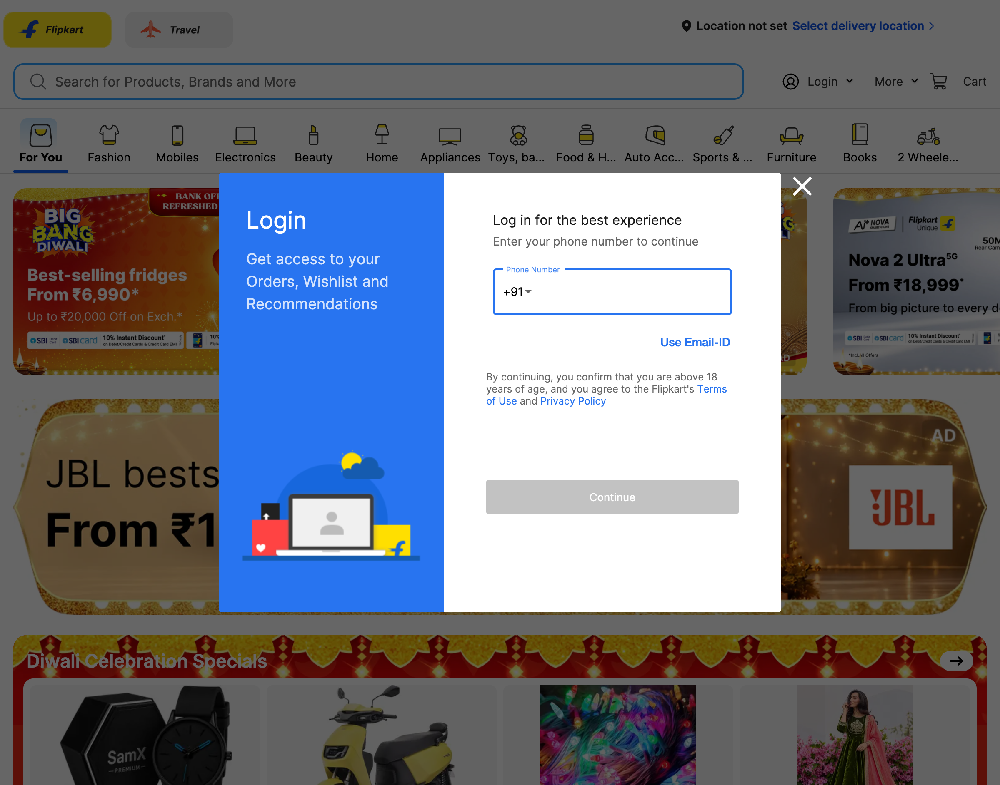
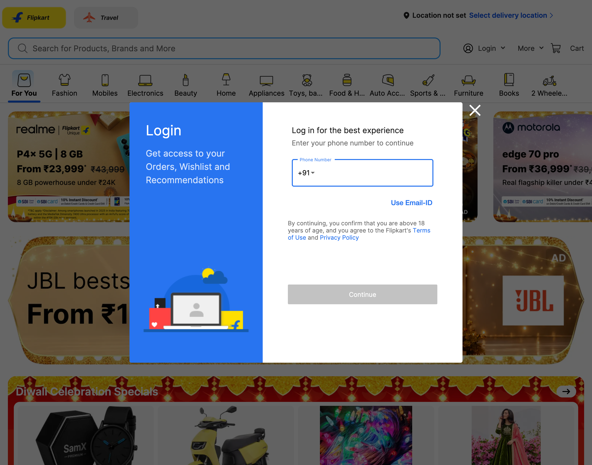
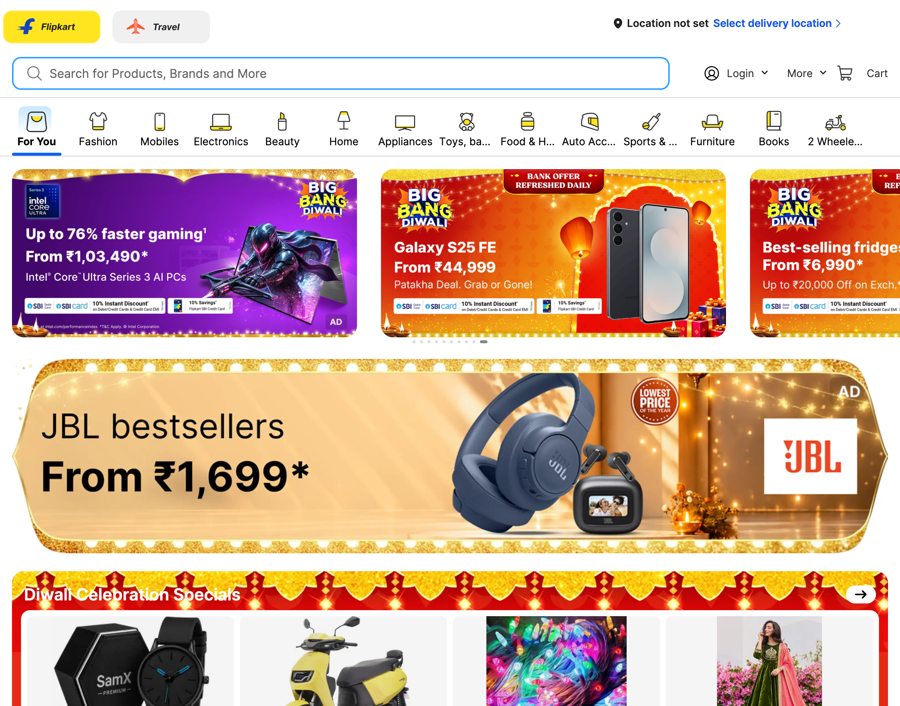
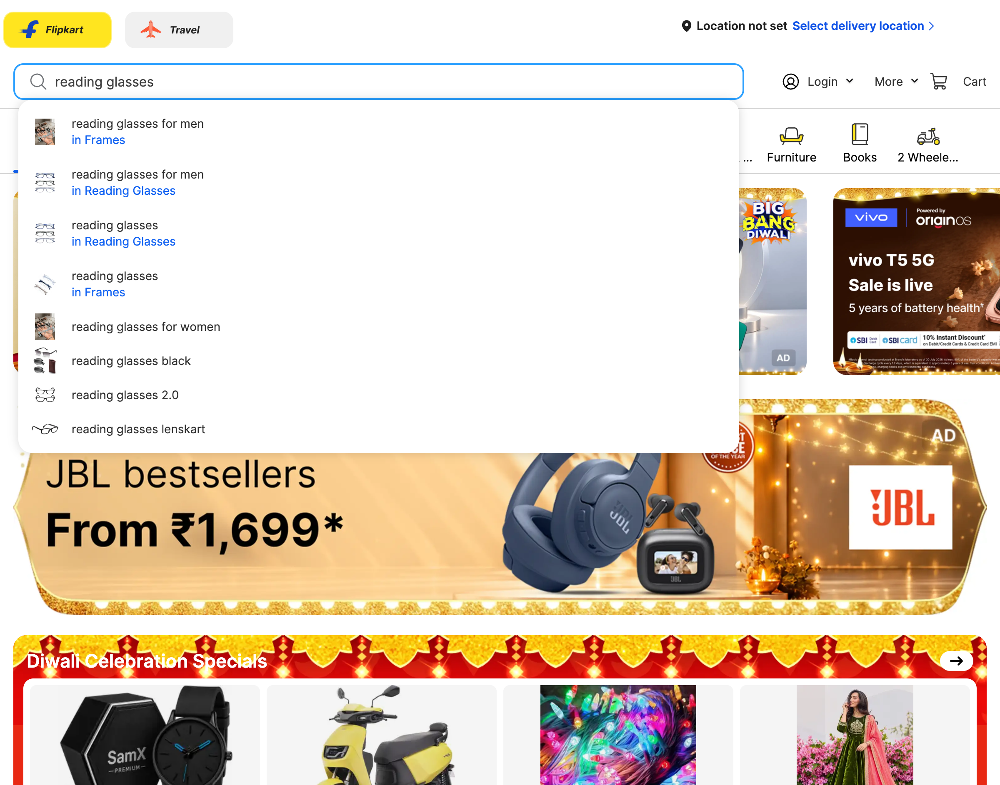

# Live Browser Interaction

- **Target URL:** https://www.flipkart.com
- **Current URL:** https://www.flipkart.com/
- **Page Title:** Online Shopping Site for Mobiles, Electronics, Furniture, Grocery, Lifestyle, Books & More. Best Offers!
- **Audit Goal:** Audit website usability and user journey
- **Status:** IN PROGRESS

## Step 0: Initial page observation

Target website loaded into live browser. Ready for inspection.

## Step 1: `press`

- **Agent reasoning:** There is a large login modal overlaying the entire screen, which is very intrusive and obscures the shopping content. As a novice user with low vision, I need to close this modal immediately to see the website content before I can start my search.
- **Target:** `body` (auto)
- **Value:** `Escape`
- **Status:** ⚠️ Action failed: `Locator.wait_for: Timeout 7000ms exceeded.
Call log:
  - waiting for get_by_text("body").first to be visible
    18 × locator resolved to hidden <a class="idDDkQ" title="Body Lotion" href="/q/body-lotion?otracker=undefined_footer">Body Lotion</a>
`
- **URL after action:** https://www.flipkart.com/

## Step 2: `press`

- **Agent reasoning:** A large login modal is currently obscuring most of the website content. Since I am new to technology and this modal is preventing me from starting my shopping journey, I need to close it immediately to see the main page and begin my search, as per the instructions.
- **Target:** `body` (auto)
- **Value:** `Escape`
- **Status:** ⚠️ Action failed: `Locator.wait_for: Timeout 7000ms exceeded.
Call log:
  - waiting for get_by_text("body").first to be visible
    17 × locator resolved to hidden <a class="idDDkQ" title="Body Lotion" href="/q/body-lotion?otracker=undefined_footer">Body Lotion</a>
`
- **URL after action:** https://www.flipkart.com/

## Step 3: `press`

- **Agent reasoning:** A large login modal is obstructing the view of the shopping website. As a novice user, I find these pop-ups confusing, so I will press 'Escape' to close it and see the main page content, as per the instructions.
- **Target:** `body` (auto)
- **Value:** `Escape`
- **Status:** ⚠️ Action failed: `Locator.wait_for: Timeout 7000ms exceeded.
Call log:
  - waiting for get_by_text("body").first to be visible
    17 × locator resolved to hidden <a class="idDDkQ" title="Body Lotion" href="/q/body-lotion?otracker=undefined_footer">Body Lotion</a>
`
- **URL after action:** https://www.flipkart.com/

## Step 4: `press`

- **Agent reasoning:** A large login modal/popup is obscuring the main content of the Flipkart website. As a novice user with low vision, I need to dismiss this overlay immediately to see the catalog and proceed with my shopping journey. I will press 'Escape' to close the pop-up.
- **Target:** `@e109` (text)
- **Value:** `Escape`
- **URL after action:** https://www.flipkart.com/

## Step 5: `fill`

- **Agent reasoning:** I need to find reading glasses. I see a large search bar at the top of the page. I will type 'reading glasses' into this box to start my search, as clicking a department category might be too overwhelming for me right now.
- **Target:** `@e3` (text)
- **Value:** `reading glasses`
- **URL after action:** https://www.flipkart.com/

## Run completed

- **Actions taken:** 5
- **Summary:** Completed 5-step live user journey exploration as Elena.
- **Output Report:** `improvements_suggestions.md`
