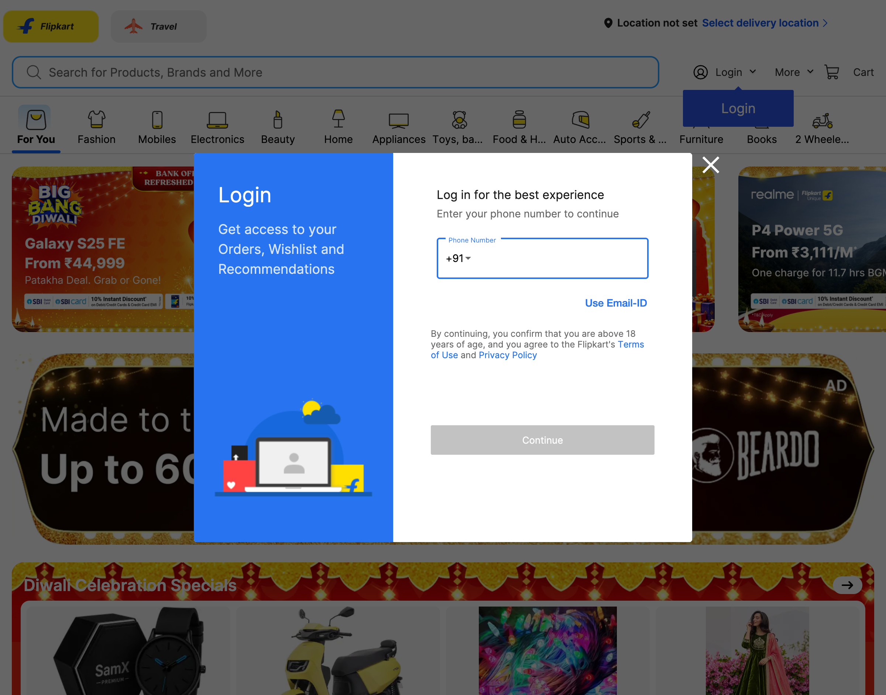
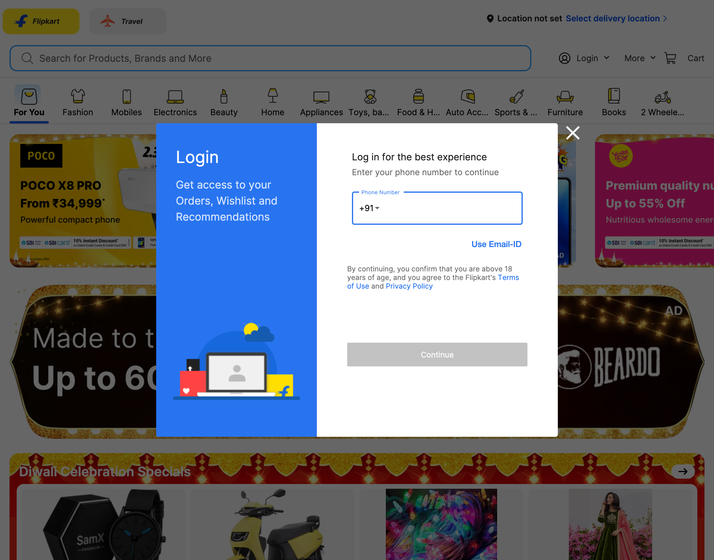
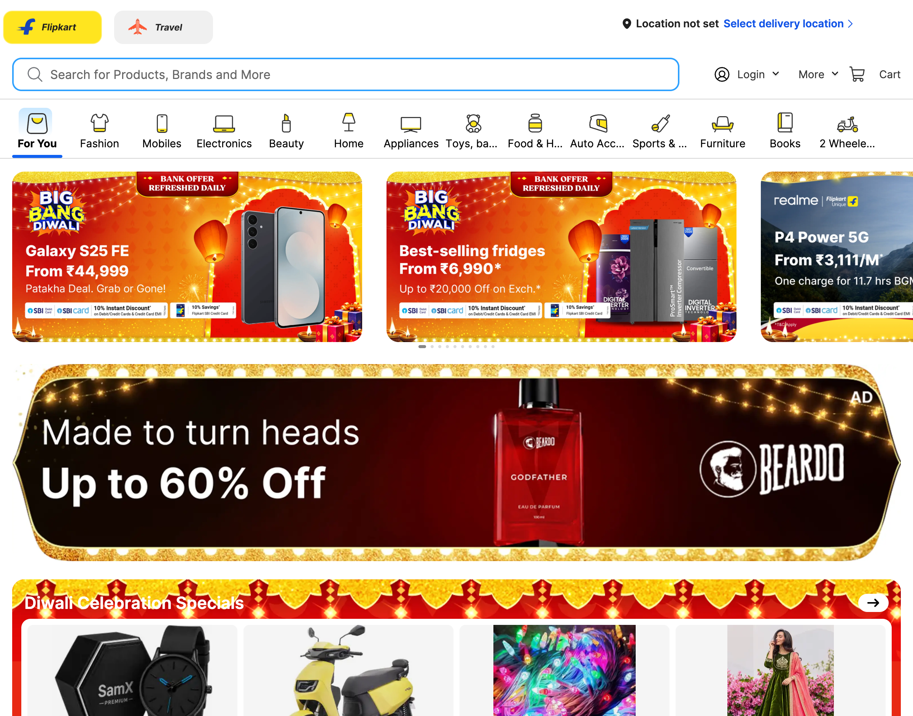
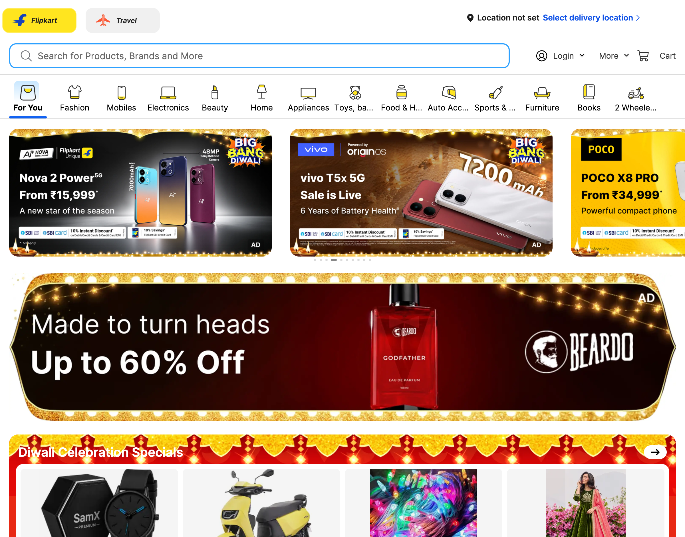
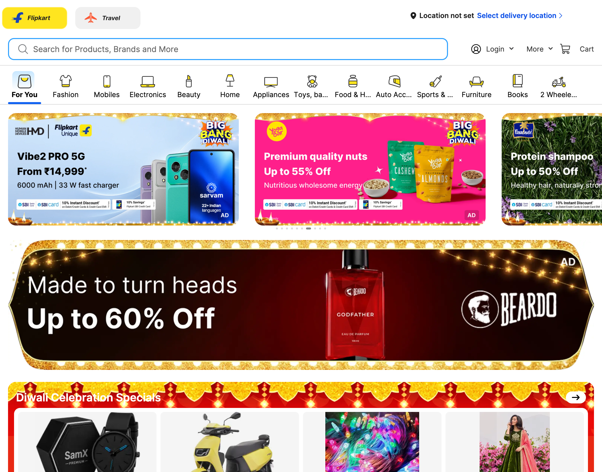
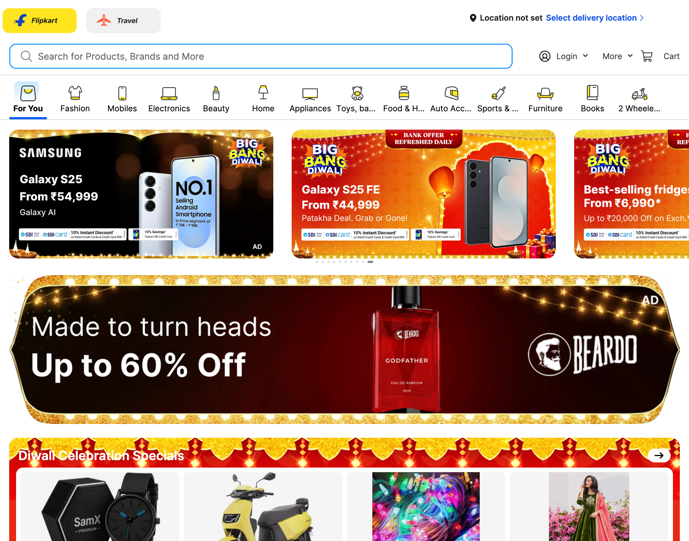

# Live Browser Interaction

- **Target URL:** https://www.flipkart.com
- **Current URL:** https://www.flipkart.com/
- **Page Title:** Online Shopping Site for Mobiles, Electronics, Furniture, Grocery, Lifestyle, Books & More. Best Offers!
- **Audit Goal:** Audit website usability and user journey
- **Status:** IN PROGRESS

## Step 0: Initial page observation

Target website loaded into live browser. Ready for inspection.

## Step 1: `press`

- **Agent reasoning:** There is a large, intrusive 'Login' modal overlaying most of the homepage content. Since my priority is to start shopping, I must dismiss this popup first to see the product catalog clearly. I will use the Escape key to close it.
- **Target:** `body` (auto)
- **Value:** `Escape`
- **Status:** ⚠️ Action failed: `Locator.wait_for: Timeout 7000ms exceeded.
Call log:
  - waiting for get_by_text("body").first to be visible
    18 × locator resolved to hidden <a class="idDDkQ" title="Body Lotion" href="/q/body-lotion?otracker=undefined_footer">Body Lotion</a>
`
- **URL after action:** https://www.flipkart.com/

## Step 2: `press`

- **Agent reasoning:** There is a large modal dialog titled 'Login' overlaying the entire page, which is obstructing my view of the shopping categories. Since I am not ready to log in, I must close this popup first to continue my shopping journey, which I plan to start by searching for reading glasses.
- **Target:** `body` (auto)
- **Value:** `Escape`
- **Status:** ⚠️ Action failed: `Locator.wait_for: Timeout 7000ms exceeded.
Call log:
  - waiting for get_by_text("body").first to be visible
    17 × locator resolved to hidden <a class="idDDkQ" title="Body Lotion" href="/q/body-lotion?otracker=undefined_footer">Body Lotion</a>
`
- **URL after action:** https://www.flipkart.com/

## Step 3: `type`

- **Agent reasoning:** I need to find reading glasses. I see a large search bar at the top of the page, which is the best place to start. I will type 'reading glasses' into this search box.
- **Target:** `@e3` (auto)
- **Value:** `reading glasses`
- **Status:** ⚠️ Action failed: `Action must be one of: click, fill, press, scroll, wait, go_back, navigate.`
- **URL after action:** https://www.flipkart.com/

## Step 4: `type`

- **Agent reasoning:** I need to find reading glasses. Since I am on the home page, the most direct way is to use the search bar. I will type 'reading glasses' into the search input field, which is large and prominent, to start my search for the item.
- **Target:** `@e3` (auto)
- **Value:** `reading glasses`
- **Status:** ⚠️ Action failed: `Action must be one of: click, fill, press, scroll, wait, go_back, navigate.`
- **URL after action:** https://www.flipkart.com/

## Step 5: `type`

- **Agent reasoning:** Since I have low vision and novice tech skills, I want to start by searching for a common item, 'reading glasses,' to see if the search function is clear. I will type the search query into the prominent search bar. I need to ensure the text input area is large and easy to see.
- **Target:** `@e3` (auto)
- **Value:** `reading glasses`
- **Status:** ⚠️ Action failed: `Action must be one of: click, fill, press, scroll, wait, go_back, navigate.`
- **URL after action:** https://www.flipkart.com/

## Run completed

- **Actions taken:** 5
- **Summary:** Completed 5-step live user journey exploration as Elena.
- **Output Report:** `improvements_suggestions.md`
